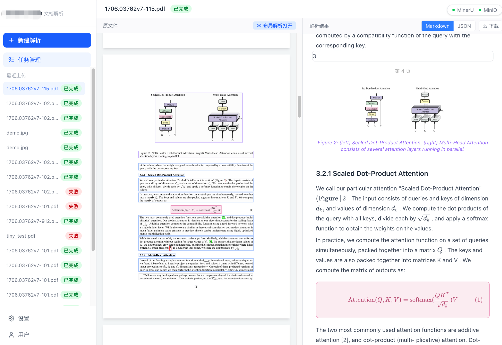

# MinerU Web Service

基于 [MinerU](https://github.com/opendatalab/MinerU) 的文档解析平台。React 前端 + FastAPI 后端，支持本地 MinerU 4.1、4.0、v3，以及 mineru.net 在线 API。后端负责文件存储、任务调度、结果提取与缓存；文档解析由 MinerU 服务完成。

最终效果图：


## 功能

- 解析来源可选：**本地 v4.1**（新版 Tasks JSON 协议）、**本地 v4.0**（旧版接口）、**在线 API**（mineru.net）、**本地 v3**（异步或同步，后者兼容 2.7.6）
- 左右双栏界面：左侧原文渲染（PDF / 图片）+ bbox 框选高亮，右侧解析内容
- PDF 与图片均支持基于 `middle_json` 的精确 bbox 对齐（原生像素坐标）；没有 `middle_json` 时（如在线 API 解析结果）自动回退到 `content_list`（归一化坐标）
- 支持文本、标题、列表、公式、表格、图片、图表（chart）等内容块的差异化渲染
- 每个文本 block 走真正的 markdown 渲染（加粗/斜体/行内代码/裸链接自动转 `<a>` 等），公式（行内 `$...$` 与块级 `$$...$$`，含表格内公式）用 KaTeX 排版，跟 mineru.net 官网的渲染方式对齐
- 图片 / 图表按 `bbox` 相对页面宽度的实际比例动态显示大小，不是固定尺寸
- 页眉、页脚、旁注等边缘内容可隐藏/显示
- 解析结果支持一键下载（Markdown / JSON）
- JSON 原始数据查看器（CodeMirror 6）
- 顶部实时显示本地 MinerU / MinIO 服务健康状态

## 架构

```
用户浏览器
    │
    ▼
React 前端（开发：port 5173 / 生产：port 80）
    │  /api/* → 反向代理
    ▼
FastAPI 后端（port 8000）
    ├── SQLite（文件元数据 + 解析结果缓存）
    ├── MinIO（原文件对象存储，生成预签名 URL 供前端预览）
    ├── GET /status（探活 MinerU + MinIO，供前端顶部状态指示器轮询）
    │
    ├── 本地 v4.1 → MinerU 4.1.6 API（MINERU_V41_URL）
    │    ├── POST /v1/tasks             JSON 文件清单或 URL，按需 PUT 上传
    │    ├── GET  /v1/tasks/{task_id}   查询任务和逐文件状态
    │    └── GET  <result_url>          逐文件下载结果 ZIP
    ├── 本地 v4.0 → MinerU 4.0.12 API（MINERU_V4_URL）
    │    ├── POST /v1/tasks             multipart 文件或旧版 JSON URL
    │    ├── GET  /v1/tasks/{task_id}   查询任务状态
    │    └── GET  /v1/tasks/{task_id}/result  读取 JSON 结果
    ├── 本地 v3 → MinerU 旧版 API（MINERU_V3_URL）
    │    ├── POST /tasks                异步提交
    │    └── POST /file_parse           同步解析，兼容 2.7.6
    │
    └── 在线解析 → HTTP 调用 mineru.net 官方云端 API
         ├── POST /api/v4/file-urls/batch              注册文件批次，获取上传地址
         ├── POST /api/v4/extract/task/batch           提交 URL 批次
         ├── PUT  <预签名地址>                          上传原文件（阿里云 OSS）
         ├── GET  /api/v4/extract-results/batch/{id}    轮询解析状态
         └── <full_zip_url>                             下载结果压缩包，后端解压入库
```

**存储职责：**

| 存储 | 存什么 | 用途 |
|------|--------|------|
| **MinIO** | 用户上传的原始文件（PDF / 图片） | 生成预签名 URL，供前端预览；URL 任务不保存远程原文件 |
| **SQLite** | 文件元数据（filename、status、created_at、mineru_task_id、cloud_batch_id 等） | 文件列表、历史记录、任务状态轮询 |
| **SQLite** | 解析结果（Markdown、`content_list`、`middle_json`、`structured_content`） | 缓存结果，供任务详情和下载使用 |

**职责划分：**

| 职责 | MinerU / mineru.net 承担 | 自建后端承担 |
|------|------------|------------|
| 文件解析（版面分析、OCR、公式、表格） | ✅ | 提交任务、传递选项 |
| 任务执行与状态 | ✅ | 轮询上游状态、更新本地记录 |
| 解析结果 | ✅ 生成 | 提取并缓存到 SQLite |
| 结果压缩包处理 | 在线 API 和本地 4.1 生成 ZIP | 解压 ZIP，处理图片引用 |
| 原文件存储 + 预览 URL | ❌ | ✅ MinIO |
| 文件列表 / 历史记录 | ❌ | ✅ SQLite |

> 本地 MinerU 的 HTTP 客户端使用 `trust_env=False`，避免系统代理影响本机服务连接。在线 API 请求可使用系统代理设置。

**解析方式对比：**

| 模式 | 前端标签 | 接口 | 说明 |
|------|---------|------|------|
| 本地 v4.1 | 默认 | JSON `POST /v1/tasks` → 按需 PUT → 轮询 → 逐文件下载 ZIP | 适配 MinerU 4.1.6；通过 `MINERU_V41_URL` 配置 |
| 本地 v4.0 | 本地 v4.0 | multipart `POST /v1/tasks` + 轮询 | 保留 4.0.12 协议与历史任务；通过 `MINERU_V4_URL` 配置 |
| 在线 API | 在线 API | mineru.net 官方云服务 | 需要用户自备 mineru.net API Key（存前端 localStorage，不落后端库），无需本地部署 MinerU；解析结果没有 `middle_json`，查看器自动用 V1（`content_list`）渲染 |
| 本地 v3 异步 | v3 默认 | `POST /tasks` + 轮询 | 保留原有异步模式 |
| 本地 v3 同步 | 兼容 2.7.6 | `POST /file_parse` | 保留原有同步模式 |

前端上传页按本地 v4.1、本地 v4.0、在线 API、本地 v3 排列；v3 下再选异步或同步。对应接口分别为 `/files/upload_v41`、`/files/upload_v4`、`/files/upload_cloud`、`/files/upload_async`、`/files/upload`。4.0 和 4.1 任务分别记录为 `local_v4`、`local_v41`，历史结果按记录中的引擎读取。

上传页的“本次解析设置”可调整本地 4.x 的质量档位与 OCR 模式，或在线 API 的 VLM/Pipeline、OCR、表格及公式选项。左下角“设置”保存当前浏览器的新任务默认值，不会修改已有任务。首页模型检查只验证后端配置的 MinerU CLI 中 Standard 档 ONNX + llama.cpp 模型文件；服务在线状态另由 `/status` 检查。其他档位须由 MinerU API 启动时提供。

本地 4.0、4.1 与在线 API 另有“文档 URL”“网页 URL”入口；网页分别使用本地 Flash 和在线 MinerU-HTML。URL 必须是可公开访问的 HTTPS 地址。URL 任务保存原始链接和解析结果，不将远程原文件复制到 MinIO，因此任务详情提供原始地址链接，不显示原文件框选预览。网页结果没有布局块时直接显示 Markdown。

内容渲染细节（markdown / 公式 / 表格 / chart / 图片宽度）见 [`frontend/README.md`](frontend/README.md#内容渲染)。

## 环境依赖


| 依赖      | 版本    | 说明                 |
| ------- | ----- | ------------------ |
| Python  | 3.13+ | 后端运行环境             |
| uv      | 最新    | Python 包管理         |
| Node.js | ^20.19.0 或 >=22.12.0 | 前端构建（Vite 8 要求） |
| pnpm    | 最新    | 前端包管理              |
| MinIO   | —     | 原文件对象存储            |
| MinerU  | 4.1.6 / 4.0.12 / v3 | 按所选本地模式部署；仅使用在线 API 时可不部署 |


## 快速启动

### 1. 准备并启动 MinerU 本地服务

如果只使用"在线 API"模式解析，可跳过这一步，直接准备好 mineru.net 的 API Key。

本地 4.1 默认使用 `standard` 档。首次使用时，先在本机 MinerU 仓库单独下载并验证该档位所需模型，再启动 API。完整安装、模型组合和 API 使用步骤见 [local_models_api.md](local_models_api.md)。

也可以在上传页选择本地 4.1 或 4.0，点击“下载模型”。页面会显示下载、校验及就绪状态，并在模型未就绪时阻止本地 4.x 文件上传。按钮通过本项目后端配置的 `MINERU_V4_CLI` 执行下面相同的下载和校验命令；首次下载可能需要较长时间，离开页面不会取消后端下载。模型就绪后，按下面最后一条命令启动 MinerU API，使模型在服务启动阶段加载。

```bash
cd /path/to/MinerU
./.venv/bin/mineru-kit models download --tier standard --small-backend onnx --vlm-engine llama-cpp --source modelscope
./.venv/bin/mineru-kit models verify --tier standard --small-backend onnx --vlm-engine llama-cpp
MINERU_MODEL_SOURCE=local MINERU_MODEL_SMALL_BACKEND=onnx MINERU_MODEL_VLM_ENGINE=llama-cpp \
  ./.venv/bin/mineru-kit api-server --host 127.0.0.1 --port 18000 --tier standard --preload-models
```

上面是本机默认生效的 ONNX + llama.cpp 组合；若改用其他后端，下载、校验与服务启动应使用同一组合。`download` 是独立的准备步骤；`verify` 未通过时先补齐模型。`MINERU_MODEL_SOURCE=local` 防止解析请求期间自动下载，`--preload-models` 在服务启动阶段加载模型。确认 `/v1/health` 返回 `status: ok` 后再上传。`--tier standard` 仅开放 Standard 及其以下档位；如需 Advanced，应先准备对应模型并调整服务启动参数。项目后端仅等待解析约 10 分钟，不承担模型下载时间。

本地 v3 继续按对应旧版方式启动，地址通过 `MINERU_V3_URL` 配置；4.0 使用 `MINERU_V4_URL`，4.1 使用 `MINERU_V41_URL`。默认两个 4.x 地址均为 18000；只运行 4.1 服务时，4.0 显示不可用属正常现象。若需同时运行两版，请让两版服务使用不同端口并分别设置地址。版本识别基于 `/v1/health` 的 `version` 和 `features`。4.1 主 API 不提供 `/v1/file_parse`，本项目使用 `/v1/tasks`。

### 2. 启动 MinIO

```bash
docker run -d -p 9000:9000 -p 9001:9001 \
  -e MINIO_ROOT_USER=minioadmin \
  -e MINIO_ROOT_PASSWORD=minioadmin \
  quay.io/minio/minio server /data --console-address ":9001"
```

### 3. 启动后端

安装 uv（如未安装）：

```bash
# macOS / Linux
curl -LsSf https://astral.sh/uv/install.sh | sh

# 或通过 pip
pip install uv
```

```bash
cd backend

# 复制并编辑配置文件（所有配置项均在此文件中）
cp .env.example .env
# 按需修改 .env

# 安装依赖（自动创建虚拟环境）
uv sync

# 激活虚拟环境
source .venv/bin/activate  # macOS / Linux
# .venv\Scripts\activate   # Windows

# 启动（开发模式，支持热重载）
uv run fastapi dev main.py
```

配置项说明见 `backend/.env.example`，由 `app/config.py` 统一加载。优先级从高到低：**环境变量 > `.env` 文件 > `config.py` 默认值**。如果 `mineru-kit` 不在后端进程的 `PATH` 中，请在 `.env` 里将 `MINERU_V4_CLI` 设为该 CLI 的实际路径。

后端 API 文档：`http://localhost:8000/docs`

启动后可访问 `http://localhost:8000/status` 确认 MinerU / MinIO 是否都探活成功（前端右上角状态指示器数据来源就是这个接口）。

### 4. 启动前端

```bash
cd frontend

# 安装依赖
pnpm install

# 开发模式启动（自动代理 /api 到 localhost:8000）
pnpm run dev
```

访问终端显示的地址；Vite 默认使用 `http://localhost:5173`，如果端口被占用可能改用 `5174`。

如果选择“在线 API”解析方式，需要在上传页填入 mineru.net 的 API Key。Key 保存在当前浏览器的 localStorage，并随解析请求发送给本项目后端，由后端调用 mineru.net；后端不将 Key 保存到数据库。

> **离线 / 内网环境**：前端 PDF 预览默认从 `unpkg.com` 加载 PDF.js worker。若无法访问外网，可改为本地加载：
>
> ```bash
> # 将 worker 文件复制到 public/
> cp node_modules/.pnpm/pdfjs-dist@*/node_modules/pdfjs-dist/build/pdf.worker.min.mjs public/
> ```
>
> 然后在 `src/components/PDFViewer.tsx` 和 `src/components/PDFViewerV2.tsx` 中，注释掉 CDN 那行，取消注释本地那行（文件内已有说明）。

## 项目结构

```
mineru-web-service/
├── backend/
│   ├── main.py                    # FastAPI 入口，CORS 配置，GET /status 健康检查
│   ├── pyproject.toml             # 依赖声明（uv）
│   ├── .env.example               # 配置模板（复制为 .env 后修改）
│   └── app/
│       ├── config.py              # 集中配置（pydantic-settings，读取 .env）
│       ├── database.py            # SQLite 连接与初始化
│       ├── models.py              # SQLAlchemy ORM 模型
│       ├── schemas.py             # Pydantic 请求/响应模型
│       ├── routers/
│       │   └── files.py           # 上传、URL 解析、任务查询与结果接口
│       └── services/
│           ├── adapters/
│           │   ├── v3.py          # 本地 v3 适配器
│           │   ├── v4.py          # 本地 4.0 适配器
│           │   ├── v41.py         # 本地 4.1 Tasks 适配器
│           │   └── cloud.py       # 在线 API 适配器
│           ├── mineru.py          # 本地 v3 调用入口
│           ├── mineru_cloud.py    # 在线 API 调用入口
│           ├── v4_models.py       # 本地 4.x 模型下载与校验
│           └── storage.py         # MinIO 文件存储 + 健康检查
│
├── frontend/
│   ├── vite.config.ts             # Vite 配置（/api 反向代理）
│   ├── src/
│   │   ├── types.ts               # TypeScript 类型定义
│   │   ├── api/
│   │   │   ├── index.ts           # 后端 API 封装
│   │   │   └── cloud.ts           # 在线 API Key 的本地存储读写
│   │   ├── utils/
│   │   │   ├── parseMiddleJson.ts      # middle_json → ParsedBlock[] 解析器（含 chart 映射、公式 $ 包裹）
│   │   │   ├── parseV4.ts              # 4.x 结构化结果解析
│   │   │   ├── parseSettings.ts        # 解析选项默认值
│   │   │   └── renderTableEquations.ts # 表格 HTML 里的 <eq> 标签替换成 KaTeX 渲染结果
│   │   ├── pages/
│   │   │   ├── HomePage.tsx       # 上传与 URL 解析（四种模式）
│   │   │   ├── SettingsPage.tsx   # 新任务默认解析设置
│   │   │   ├── TaskListPage.tsx   # 历史记录列表
│   │   │   └── TaskDetailPage.tsx # 解析结果双栏查看器
│   │   └── components/
│   │       ├── PDFViewerV2.tsx    # PDF 渲染 + bbox 高亮（middle_json，原生坐标）
│   │       ├── PDFViewer.tsx      # PDF 渲染 + bbox 高亮（content_list，归一化坐标）
│   │       ├── ContentViewerV2.tsx # 内容块渲染（middle_json）
│   │       ├── ContentViewer.tsx  # 内容块渲染（content_list）
│   │       ├── ImageViewerV2.tsx  # 图片查看器 + bbox 高亮（middle_json，原生坐标）
│   │       ├── ImageViewer.tsx    # 图片查看器 + bbox 高亮（content_list，归一化坐标）
│   │       ├── Markdown.tsx       # markdown + 公式渲染
│   │       ├── SelectField.tsx    # 解析选项选择器
│   │       ├── SystemStatus.tsx   # 顶部 MinerU / MinIO 服务状态指示器
│   │       └── JsonViewer.tsx     # JSON 数据查看器（CodeMirror 6）
│   └── package.json
│
├── local_models_api.md           # 本地 4.1 安装、模型准备与 API 使用
└── README.md
```

## 后端 API


| 方法 | 路径 | 说明 |
|------|------|------|
| `POST` | `/files/upload` | 上传并同步解析（本地 MinerU，`POST /file_parse`，兼容 2.7.6） |
| `POST` | `/files/upload_async` | 上传并异步解析（本地 MinerU v3，`POST /tasks` + 轮询） |
| `POST` | `/files/upload_v4` | 上传并异步解析（本地 MinerU 4.0，multipart Tasks + 轮询） |
| `POST` | `/files/upload_v41` | 上传并异步解析（本地 MinerU 4.1，JSON Tasks + 上传链接 + 逐文件 ZIP） |
| `POST` | `/files/upload_cloud` | 上传并使用在线 API（mineru.net）解析，需附带 `api_key` 表单字段 |
| `POST` | `/files/parse_url` | 提交 HTTPS 文档或网页 URL，使用本地 4.0、4.1 或在线 API 解析 |
| `GET` | `/files` | 文件列表 |
| `GET` | `/files/{id}/status` | 本地任务状态 |
| `GET` | `/files/{id}/result` | 文件详情 + 解析结果 |
| `GET` | `/files/{id}/content_list` | 解析结果（content_list 格式） |
| `GET` | `/files/{id}/middle_json` | 解析结果（middle_json 格式，含精确 bbox，仅本地解析可能有） |
| `GET` | `/files/{id}/structured_content` | 本地 4.x 结构化解析结果 |
| `GET` | `/files/{id}/download_url` | 原文件预签名下载 URL（MinIO 生成） |
| `GET` | `/files/{id}/mineru_status` | 查询本地 MinerU 异步任务原始状态（本地异步模式专用） |
| `DELETE` | `/files/{id}` | 删除记录及 MinIO 文件 |
| `GET` | `/status` | 分别探活本地 v3、v4.0、v4.1 服务与 MinIO |
| `GET` | `/models/v4` | 检查配置的 MinerU CLI 中 Standard ONNX + llama.cpp 模型文件状态 |
| `POST` | `/models/v4/download` | 通过本项目后端触发模型下载并自动校验 |


## 技术栈

**前端**

- React 19 + TypeScript + Vite 8
- Tailwind CSS 4
- react-pdf（PDF 渲染）
- react-markdown + remark-gfm + remark-math + rehype-katex + katex（内容 markdown / 公式渲染）
- @uiw/react-codemirror（JSON 查看器）
- lucide-react（图标）

**后端**

- FastAPI + Uvicorn
- SQLAlchemy + SQLite
- MinIO Python SDK
- httpx（调用本地 MinerU 与 mineru.net）
